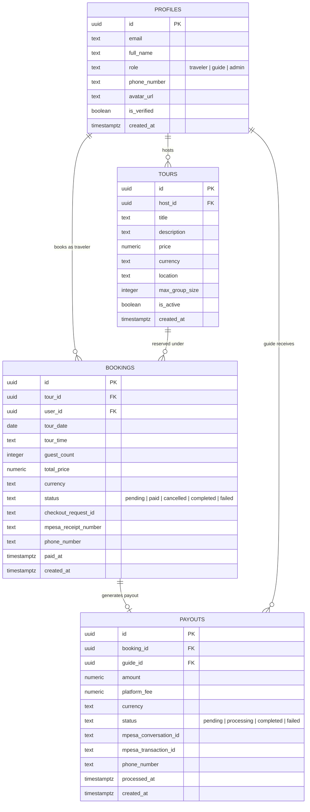

# Ausaguide Technical Architecture Blueprint

A complete end-to-end technical reference of the **Ausaguide** platform architecture, data flows, database schemas, API integrations, and security enforcement mechanisms. This document is designed for technical onboarding, developer audits, and investor technical due diligence.

---

## 1. Tech Stack Overview

Ausaguide is architected as an event-driven, serverless, micro-service-backed platform tailored for high responsiveness, low maintenance overhead, and rock-solid payment processing in East Africa.

| Layer | Technology | Key Selection Rationale |
| :--- | :--- | :--- |
| **Frontend Framework** | **React 18 + TypeScript** | Strongly typed component model, rich ecosystem for reactive UI, high developer velocity, and modular state management for interactive booking flows. |
| **Build & Tooling** | **Vite** | Extremely fast Hot Module Replacement (HMR), tree-shaking, fast ESM builds, and zero cold-start latency compared to traditional bundlers. |
| **Styling & UI** | **Tailwind CSS + Lucide Icons** | Utility-first CSS ensuring minimal bundle size via automatic purge, consistent design tokens, responsive breakpoints, and polished custom styling without bloated runtime CSS-in-JS. |
| **Backend & DB** | **Supabase (PostgreSQL 15)** | Managed PostgreSQL with native Row-Level Security (RLS), real-time WebSocket subscriptions, secure Auth & JWT handling, file storage buckets, and built-in database migrations. |
| **Serverless Compute** | **Supabase Edge Functions (Deno / TypeScript)** | Distributed, low-latency V8 isolates that execute server-side business logic and payment workflows close to users, without provisioning or managing virtual machines or containers. |
| **Hosting & CI/CD** | **Vercel** | Global edge network (CDN), automated git preview and production deployments, instant cache invalidation, automatic SSL termination, and sub-100ms asset delivery worldwide. |
| **Payment Gateway** | **Safaricom Daraja API 2.0 (M-Pesa)** | The undisputed standard for consumer transactions in Kenya. Native support for Lipa Na M-Pesa Online (C2B STK Push) and Business-to-Customer (B2C) automated guide payouts. |
| **Transactional Email** | **Brevo (formerly Sendinblue)** | High deliverability SMTP/REST API, rich template support, domain verification (DKIM/SPF), and webhook analytics for booking notifications and password resets. |

---

## 2. Payment Data Flow Diagram

The following text diagram details how an M-Pesa transaction is initiated, securely routed, authorized by the traveler on their mobile device, and reconciled asynchronously via webhook callbacks.

```text
+-------------------+
|  React Frontend   |
|   (Client App)    |
+---------+---------+
          |
   1. User clicks "Pay with M-Pesa"
      (Provides Phone & Booking ID)
          |
          v
+---------+----------------------------------------------------+
| Supabase Edge Function: `mpesa-stk-push`                     |
|                                                              |
| - Verifies booking state and price                           |
| - Requests OAuth token from Daraja (Basic Auth Consumer Key) |
| - Computes Base64 Password: Passkey + Timestamp             |
| - Dispatches STK Push to Safaricom Daraja API                |
+---------+----------------------------------------------------+
          |
   2. Returns CheckoutRequestID & sets booking status to 'pending'
          |
          v
+---------+----------------------------------------------------+
| Safaricom Daraja Gateway                                     |
|                                                              |
| - Sends USSD Push prompt to Traveler's Mobile Phone          |
+---------+----------------------------------------------------+
          |
   3. Traveler inputs M-Pesa PIN & approves payment
          |
          v
+---------+----------------------------------------------------+
| Safaricom Daraja Core System                                 |
|                                                              |
| - Settles mobile money balance                               |
| - Sends HTTP POST Callback to registered Webhook URL         |
+---------+----------------------------------------------------+
          |
   4. HTTPS POST Payload (ResultCode, Receipt, Amount, CheckoutRequestID)
          |
          v
+---------+----------------------------------------------------+
| Supabase Edge Function: `mpesa-callback`                     |
|                                                              |
| - Validates payload structure (Body.stkCallback)             |
| - Resolves booking by CheckoutRequestID or AccountReference  |
| - Idempotency check: ensures booking isn't already paid     |
| - If ResultCode === 0:                                       |
|     a. Updates `bookings`: status='paid', mpesa_receipt      |
|     b. Creates `payouts` ledger entry (80% Guide, 20% Plat)  |
|     c. Fetches Host info and calls `send-email` (Brevo)      |
| - If ResultCode !== 0:                                       |
|     a. Updates `bookings`: status='failed'                   |
|     b. Logs error to `error_logs` table                      |
| - Returns HTTP 200 { ResultCode: 0, ResultDesc: "Success" }  |
+---------+----------------------------------------------------+
          |
   5. Database state updated & Realtime WebSocket fires
          |
          v
+---------+----------------------------------------------------+
| Supabase PostgreSQL Database                                 |
|                                                              |
| - `bookings` table: status updated to 'paid'                 |
| - `payouts` table: host split queued for release             |
| - Client UI listening via Supabase Realtime updates instantly|
+--------------------------------------------------------------+
```

---

## 3. Database Schema

The core relational architecture centers around identities, listings, reservations, and financial settlements.



### Table Details & Relationship Logic

1. **`profiles`**
   - Automatically populated on user signup via an internal PostgreSQL trigger bound to `auth.users`.
   - Stores user metadata, contact information, identity verification flags (`is_verified`), and RBAC roles (`traveler`, `guide`, `admin`).
   - One guide profile can create many `tours`. One traveler profile can make many `bookings`.

2. **`bookings`**
   - Represents a specific tour reservation.
   - Holds reference to both the customer (`user_id`) and the listing (`tour_id`).
   - Stores critical payment state: `checkout_request_id` (used as the primary correlation key with Safaricom) and `mpesa_receipt_number`.
   - Transitions through states: `pending` $\rightarrow$ `paid` (or `failed`) $\rightarrow$ `completed`.

3. **`payouts`**
   - Represents the automated financial reconciliation and escrow release for tour guides.
   - Maintains a 1-to-1 relationship with confirmed `bookings` and links to the recipient guide (`guide_id`).
   - Tracks the financial split (80% net to guide, 20% platform commission) and records M-Pesa B2C identifiers (`mpesa_conversation_id`, `mpesa_transaction_id`).

---

## 4. API Integrations

Ausaguide interfaces directly with external financial and communication backends through isolated Supabase Edge Functions.

### 4.1. M-Pesa C2B STK Push (`/mpesa-stk-push`)
- **Upstream Safaricom Endpoint:** `POST /mpesa/stkpush/v1/processrequest`
- **Authentication:** OAuth 2.0 Bearer Token generated dynamically via Daraja's `/oauth/v1/generate?grant_type=client_credentials` using the Consumer Key and Consumer Secret.
- **Payload Structure:**
  ```json
  {
    "BusinessShortCode": "174379",
    "Password": "<Base64(Shortcode + Passkey + Timestamp)>",
    "Timestamp": "20261023233000",
    "TransactionType": "CustomerPayBillOnline",
    "Amount": 1500,
    "PartyA": "2547XXXXXXXX",
    "PartyB": "174379",
    "PhoneNumber": "2547XXXXXXXX",
    "CallBackURL": "https://<PROJECT-REF>.supabase.co/functions/v1/mpesa-callback",
    "AccountReference": "<BOOKING_ID>",
    "TransactionDesc": "Ausaguide Tour Booking"
  }
  ```
- **Function Responsibility:** Sanitizes customer phone number format (converts `07...` or `+254...` to `254...`), logs the outgoing request, updates the booking with the returned `CheckoutRequestID`, and returns this reference to the frontend to start listening.

### 4.2. M-Pesa B2C Automated Payouts (`/mpesa-b2c-payout`)
- **Upstream Safaricom Endpoint:** `POST /mpesa/b2c/v1/paymentrequest`
- **Use Case:** Disbursing funds to the tour guide's phone number upon tour completion or admin approval.
- **Authentication:** Requires credential encryption using Safaricom's public X.509 certificate to generate an encrypted `SecurityCredential`.
- **Command ID:** `BusinessPayment` or `SalaryPayment`.
- **Payload Parameters:**
  - `InitiatorName`: Dedicated M-Pesa portal API operator.
  - `SecurityCredential`: Encrypted operator password.
  - `PartyA`: B2C Paybill/Shortcode.
  - `PartyB`: Guide's verified phone number (`254...`).
  - `QueueTimeOutURL` & `ResultURL`: Webhook endpoints to handle asynchronous disbursement status.

### 4.3. Webhook Verification & Processing Logic (`/mpesa-callback`)
- Safaricom delivers callbacks via HTTP `POST` containing `Body.stkCallback`.
- **Callback Verification Logic:**
  1. **Structure Validation:** Checks presence of `stkCallback`, extracting `ResultCode`, `ResultDesc`, and `CheckoutRequestID`.
  2. **Booking Resolution:** Looks up the target booking using `CheckoutRequestID`. If unmatched, falls back to parsing `AccountReference` within `CallbackMetadata.Item`.
  3. **Idempotency Guard:** Verifies whether `booking.status === 'paid'`. If already paid, short-circuits gracefully to avoid double crediting or duplicate payout records.
  4. **Success Handling (`ResultCode === 0`):**
     - Extracts `MpesaReceiptNumber`, `Amount`, and `PhoneNumber`.
     - Updates booking record to `paid` with timestamp.
     - Calculates guide payout split and inserts into `payouts` with status `pending`.
     - Triggers transactional confirmation email to host via internal call to `send-email`.
  5. **Failure / Cancellation Handling (`ResultCode !== 0`):**
     - User cancelled, entered wrong PIN, or timed out.
     - Sets booking status to `failed` with descriptive reason.
     - Writes record to `error_logs` for auditability.
  6. **Response Contract:** Always returns HTTP 200 with `{ "ResultCode": 0, "ResultDesc": "Success" }` to prevent Safaricom from retrying previously handled events.

### 4.4. Transactional Notifications (`/send-email`)
- **Provider:** Brevo REST API v3 (`https://api.brevo.com/v3/smtp/email`).
- **Authentication:** `api-key: BREVO_API_KEY`.
- **Function Responsibility:** Generic microservice accepting recipient email, recipient name, subject line, and formatted HTML body. Invoked asynchronously by payment callbacks to dispatch booking receipts to travelers and host notifications to guides.

---

## 5. Security & Error Handling

Ausaguide enforces a zero-trust model across its client-server boundary and external integrations.

### 5.1. Row-Level Security (RLS)
PostgreSQL Row-Level Security is strictly enabled on all application tables. The client connects with the public `anon` key, meaning queries are executed under the caller's JWT scope:

- **`profiles`:**
  - `SELECT`: Publicly visible for verified profiles (allowing travelers to view guide bios).
  - `UPDATE`: Constrained to `auth.uid() = id`. Users can only edit their own profile.
  - Special restriction: Users cannot alter their own `role` or `is_verified` status (enforced via database triggers).
- **`bookings`:**
  - `SELECT`: Restricted to either the customer who booked (`auth.uid() = user_id`) or the tour host (`auth.uid() = tours.host_id`).
  - `INSERT`: Allowed for authenticated users where `auth.uid() = user_id`.
  - `UPDATE`: Limited to owner for cancellations; payment status transitions can **only** be executed via the `service_role` key inside Edge Functions.
- **`payouts`:**
  - `SELECT`: Restricted to the guide receiving the funds (`auth.uid() = guide_id`) or system administrators.
  - `INSERT` / `UPDATE`: Denied to all public/authenticated users. Only executable by serverless Edge Functions using the `SUPABASE_SERVICE_ROLE_KEY`.

### 5.2. Webhook Security & Secret Isolation
- **Environment Isolation:** Secrets such as `SUPABASE_SERVICE_ROLE_KEY`, `MPESA_CONSUMER_KEY`, `MPESA_CONSUMER_SECRET`, `MPESA_PASSKEY`, and `BREVO_API_KEY` are stored exclusively within Supabase Secret Vault and are **never** prefixed with `VITE_` or exposed to the client bundle.
- **Edge Function Authorization:** The callback endpoint runs with isolated privileges:
  - While Daraja sends webhook notifications over public HTTPS without standard JWT headers, the callback endpoint accepts inputs, validates the payload scheme, and performs writes exclusively using the backend `service_role` client.
  - STK Push and B2C payout triggers require an authenticated user JWT to prevent unauthorized trigger invocations.

### 5.3. Centralized Audit & Error Logging (`error_logs`)
The platform maintains a dedicated, persistent `error_logs` table to guarantee observability across serverless environments and client exceptions:

```sql
CREATE TABLE public.error_logs (
  id UUID DEFAULT gen_random_uuid() PRIMARY KEY,
  user_email TEXT,
  error_context TEXT,
  error_message TEXT,
  metadata JSONB,
  created_at TIMESTAMPTZ DEFAULT NOW()
);
```

- **Policy:** Allows write-only (`INSERT`) operations from `anon`, `authenticated`, and `service_role` actors.
- **Read Access:** Restricted strictly to platform administrators via RLS check (`profiles.role = 'admin'`).
- **Telemetry Coverage:**
  - M-Pesa payment failures, timeout drops, and validation errors.
  - Edge function execution anomalies and Brevo API dispatch failures.
  - Client-side unhandled promise rejections and boundary errors.

---

## 6. Architecture Summary for Stakeholders

- **Scalability:** The frontend is statically hosted across globally distributed edge nodes on Vercel. Database transactions and Edge Functions autoscale on Supabase's managed infrastructure without requiring server maintenance or devops overhead.
- **Financial Compliance:** Payment transactions follow an auditable double-entry trail: an M-Pesa checkout ID maps directly to a booking, which upon confirmation deterministically creates a payout record split between platform margin and guide compensation.
- **Security Posture:** Secrets are isolated in edge runtimes, row-level policies prevent data leakage across users, and all mission-critical state transitions occur exclusively on the backend.
